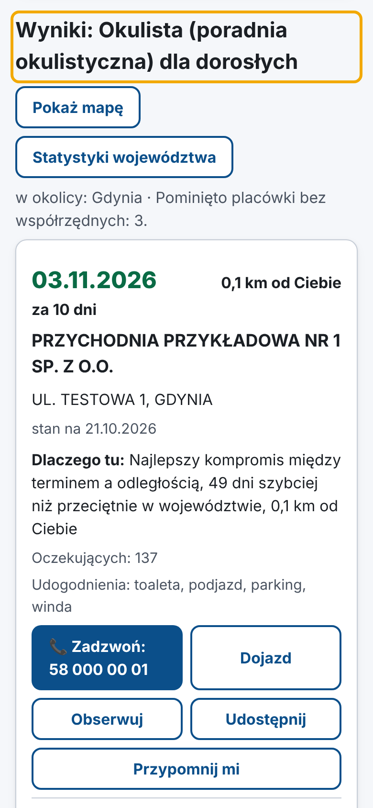
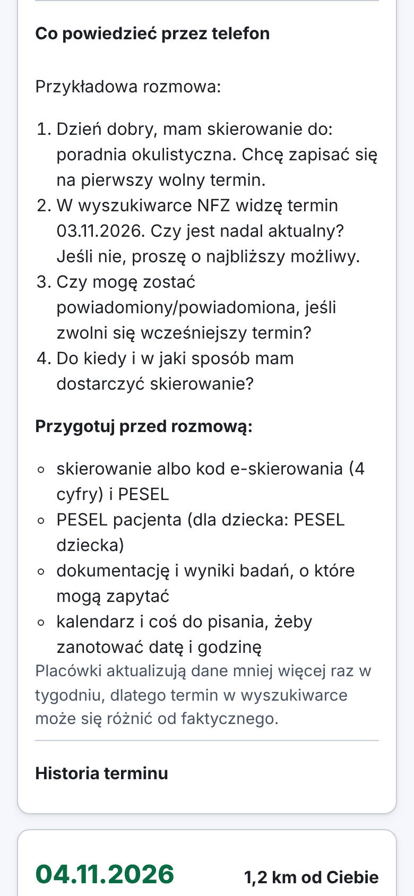
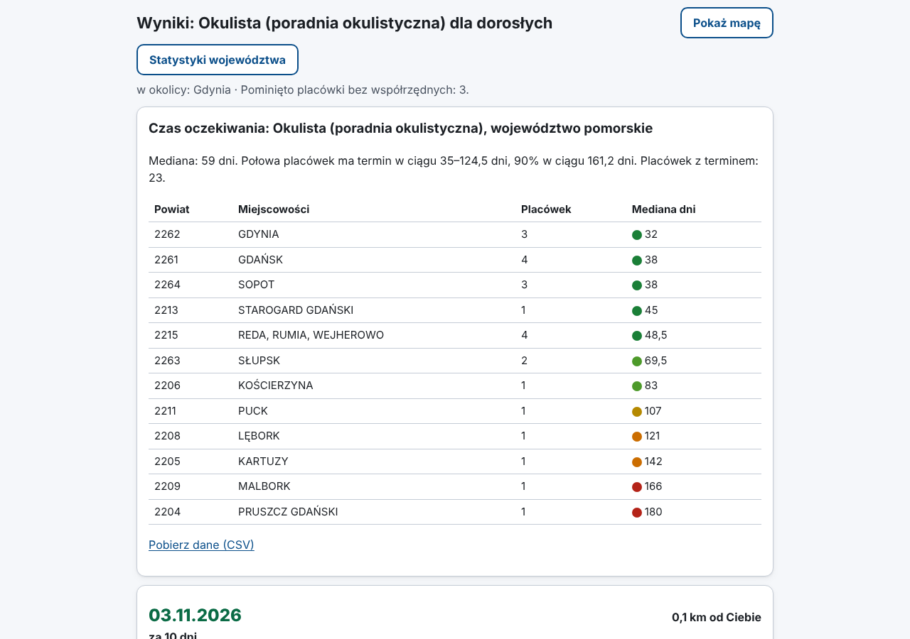

# Termin

**Najszybszy termin u specjalisty na NFZ, a od razu: gdzie, jak daleko, jak dojechać i pod jaki
numer zadzwonić.**

Termin przeszukuje publiczne dane NFZ o kolejkach, rozumie zwykły język („okulsta”, „rezonans
kolana”, „zacma”), liczy odległość od Ciebie i podpowiada, co powiedzieć przez telefon. Może też
dać znać, gdy pojawi się wcześniejszy termin. Bez reklam, a konto jest opcjonalne. To projekt open-source,
**nie jest oficjalną aplikacją NFZ**.

[English version](README.en.md)

| Wyniki na telefonie | Co powiedzieć przez telefon | Statystyki województwa |
|---|---|---|
|  |  |  |

<sub>Zrzuty pokazują fikcyjne dane testowe (nazwy placówek i telefony są zmyślone).</sub>

## Dla kogo

- **Dla każdego, kto ma skierowanie** i chce szybko znaleźć najbliższy sensowny termin.
- **Dla seniorów**: duży, czytelny tekst (przycisk „Duży tekst”), proste formularze, przycisk
  „Zadzwoń” i gotowy skrypt rozmowy.
- **Dla dzieci, które załatwiają sprawy za rodziców**: link do wyników można wysłać SMS-em
  („Udostępnij”), a przypomnienie „zadzwoń jutro rano” dodać do kalendarza.
- **Dla dziennikarzy i badaczy**: historia kolejek, mediany i percentyle czasu oczekiwania
  w województwach, eksport do CSV/JSON.

## Co potrafi

- 🔎 **Rozumie, czego szukasz**: synonimy („kardiolog”, „MRI”, „TK”, „endoproteza biodra”),
  literówki i brak polskich znaków. Dopyta, czy szukasz dla dziecka, czy dla dorosłego.
- 📍 **Liczy odległość**: od adresu, kodu pocztowego albo GPS. Opcjonalnie liczy czas dojazdu autem.
- ⚖️ **Sortuje z głową**: najszybciej, najbliżej albo kompromis („ile km dalej pojadę za dzień
  szybciej”). Każdy wynik ma jedno zdanie „dlaczego tu”.
- ⚠️ **Ostrzega**: dane starsze niż 14 dni, termin w przeszłości, brak telefonu. Zawsze pokazuje „stan na”.
- 🔔 **Powiadamia o wcześniejszym terminie**: ntfy (bez konta), Telegram, e-mail, powiadomienia
  na pulpicie. Pisze tylko wtedy, gdy pojawi się coś lepszego.
- 📈 **Pokazuje trendy**: czy kolejka w placówce się skraca, mediana czasu oczekiwania
  w województwie, mapa cieplna powiatów.
- 📱 **Instalujesz jak aplikację** na telefonie (Android, iPhone) i komputerze, bez sklepu z
  aplikacjami (PWA). Działa też offline, w trzech językach (polski, angielski, ukraiński) i
  spełnia WCAG 2.1 AA.
- 👤 **Opcjonalne konto**: obserwacje na wielu urządzeniach, eksport i usunięcie danych
  jednym kliknięciem. Kody odzyskiwania („Nie pamiętam hasła” działa nawet bez poczty),
  weryfikacja dwuetapowa kodem z aplikacji, lista zalogowanych urządzeń. Bez konta też wszystko działa.
- 🔒 **Bezpieczeństwo i prywatność**: zgoda RODO na dane o zdrowiu, brak śledzenia,
  bezpieczne sesje, ochrona CSRF, CSP, limity logowania (szczegóły w [SECURITY.md](SECURITY.md)).
  Regulamin, polityka prywatności, cookies i deklaracja dostępności są wbudowane.

## Szybki start w 30 sekund

**Panel w przeglądarce (Docker):**

```bash
git clone https://github.com/promilek2/pawel2jarzembowski-oss.git termin && cd termin
docker compose up -d
# otwórz http://localhost:8000
```

**Wiersz poleceń:**

```bash
pipx install termin-nfz
termin szukaj okulista --gdzie "81-310 Gdynia" --promien 30
termin szukaj rezonans --gdzie Kraków --tryb najszybciej
termin szukaj kardiolog --dla-dzieci -w mazowieckie --json
```

Więcej komend: `termin --help` (`statystyki`, `historia`, `eksport`, `obserwuj`, `watcher`,
`telegram`, `serwer`, `dane usun`).

**Powiadomienia przez ntfy** (aplikacja ntfy na telefon, bez konta):

```bash
termin obserwuj dodaj okulista --gdzie Gdynia --promien 30 --kanal ntfy --cel moj-tajny-temat-123 --zgoda
termin watcher            # sprawdza co godzinę i wysyła powiadomienia
```

**Na telefonie bez własnego serwera:** kliknij
[](https://render.com/deploy?repo=https://github.com/promilek2/pawel2jarzembowski-oss/tree/claude/termin-nfz-setup-inoylh),
zaloguj się w Render (darmowy plan), a po kilku minutach otwórz adres `https://….onrender.com`
na telefonie i kliknij „Zainstaluj”.

Wdrożenie na serwer (VPS, Fly.io, Render) i lista obowiązków prawnych przed publicznym
uruchomieniem: [docs/DEPLOY.md](docs/DEPLOY.md).

## Dla dziennikarzy i badaczy

Każde wyszukiwanie i każdy przebieg obserwatora zapisuje snapshot publicznych danych NFZ.
Z czasem powstaje z tego historia kolejek, której oficjalna wyszukiwarka nie pokazuje:

```bash
termin snapshot rezonans -w mazowieckie          # albo cyklicznie: TERMIN_TRACKED_QUERIES
termin statystyki rezonans -w mazowieckie --json # mediana, p25/p75/p90, powiaty
termin eksport --format csv --od 2026-01-01 -o kolejki.csv
```

API panelu: `/api/export.csv`, `/api/export.json`, `/api/stats`. Publikując analizy, podaj
źródło: **NFZ „Terminy leczenia”** (dane publiczne).

## FAQ

**Czy to oficjalna aplikacja NFZ?**
Nie. Termin to niezależny projekt open-source. Korzysta z publicznego API NFZ, tego samego,
z którego korzysta oficjalna wyszukiwarka
[terminyleczenia.nfz.gov.pl](https://terminyleczenia.nfz.gov.pl). Nie używamy logo NFZ.

**Skąd są dane?**
Z API NFZ „Terminy leczenia” (`api.nfz.gov.pl`). Placówki same raportują terminy do NFZ.
Adresy zamieniamy na współrzędne przez OpenStreetMap (Nominatim). Szczegóły i licencje:
[docs/DATA_SOURCES.md](docs/DATA_SOURCES.md).

**Dlaczego termin się nie zgadza, gdy dzwonię?**
Placówki aktualizują dane mniej więcej raz w tygodniu, a terminy zmieniają się codziennie.
Dlatego przy każdym wyniku pokazujemy „stan na” i ostrzegamy, gdy dane są starsze niż 14 dni.
Traktuj wynik jako wskazówkę, gdzie warto zadzwonić najpierw.

**Czy to porada medyczna?**
Nie. Pokazujemy wyłącznie fakty o terminach i nie oceniamy, gdzie leczą lepiej. O tym, do jakiego
specjalisty iść, decyduje lekarz, który wystawia skierowanie.

**Co z moimi danymi?**
Nie mamy analityki ani reklam, a konto jest opcjonalne. Do obserwowania zapisujemy tylko to,
co sam podasz, za Twoją wyraźną zgodą. Każdą obserwację i całe konto usuniesz jednym
kliknięciem. Szczegóły: [PRIVACY.md](PRIVACY.md) i strona `/prywatnosc` w panelu.

**Jak zainstalować na telefonie?**
Otwórz panel w przeglądarce i kliknij „Zainstaluj”. Na iPhonie: Udostępnij → Do ekranu
początkowego. Nie potrzebujesz sklepu z aplikacjami.

**Nie mogę znaleźć świadczenia.**
Sprawdź, jak nazywa je NFZ: `termin swiadczenia <fragment>`. Brakujący synonim możesz dodać
w [termin/data/synonyms.toml](termin/data/synonyms.toml). Instrukcja jest w [CONTRIBUTING.md](CONTRIBUTING.md).

## Dla programistów

Python 3.11+, FastAPI, Pydantic v2, httpx, SQLite. Frontend bez frameworka (ADR-0004).

```bash
uv venv && uv pip install -e ".[dev]"
pytest && ruff check . && mypy --strict termin
python -m tests.e2e.server    # panel z fikcyjnymi danymi, bez dostępu do NFZ
```

Architektura i konwencje: [CLAUDE.md](CLAUDE.md), plan i decyzje: [docs/PLAN.md](docs/PLAN.md),
[docs/adr/](docs/adr/). Jak pomóc: [CONTRIBUTING.md](CONTRIBUTING.md).

## Licencja

[MIT](LICENSE). Dane: NFZ (dane publiczne). Mapa: © współtwórcy OpenStreetMap.
